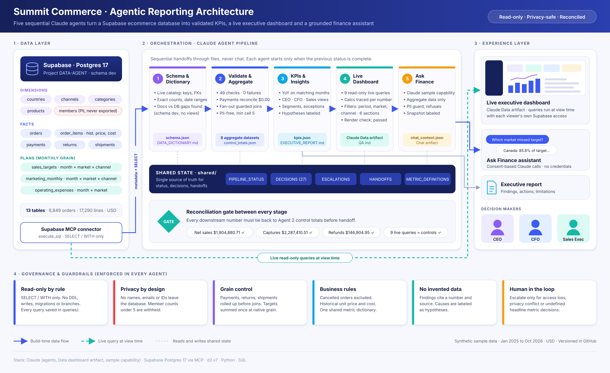

# Ecommerce-DataAnalyst-V2

A five-agent ecommerce reporting pipeline built with Claude on a Supabase (Postgres 17) database. It turns the Summit Commerce sample dataset into a validated data dictionary, privacy-safe datasets, an executive report, a live dashboard and a grounded Q and A page.

## Architecture



Source: [`docs/architecture.svg`](docs/architecture.svg)

| Layer | What it does |
|---|---|
| 1. Data | Supabase Postgres 17, schema `dev`, 13 tables (dimensions, facts, monthly plans), reached through the Supabase MCP connector with SELECT-only queries |
| 2. Orchestration | Five Claude agents run in sequence and hand off through files in `shared/` and `outputs/`; a reconciliation gate ties every stage back to Agent 2 control totals |
| 3. Experience | Live Claude Data dashboard (queries at view time), Ask Finance assistant grounded on validated aggregates, executive report for the CEO, CFO and Sales Executive |
| 4. Governance | Read-only by rule, privacy by design (no member-level data, minimum cell size 5), grain control, shared metric definitions, no invented data, human escalation |

All data is synthetic sample data (fictional retailer "Summit Commerce", Jan 2025 to Oct 2026, USD). No real customer data is included, and no member names, emails or IDs appear in any output.

## Live artifacts

| Artifact | Link | Notes |
|---|---|---|
| Executive dashboard | https://claude.ai/artifact/8wVUT8tNHAs9GaMdFap9wF | Live read-only Supabase queries; viewers need their own Supabase connector with access to the project |
| Ask Finance | https://claude.ai/artifact/TYy2boJgzvXTZTE1cZdpgx | Chat grounded on validated aggregates (snapshot through 2026-10-31) |

Both are private to the owner unless shared from claude.ai.

## Pipeline

| Agent | Role | Main outputs |
|---|---|---|
| 1 | Data dictionary from live Supabase metadata | `outputs/agent1/` |
| 2 | Read-only validation, reconciliation, privacy-safe aggregated datasets | `outputs/agent2/` |
| 3 | Executive KPIs, trends, segments, findings for CEO, CFO and Sales | `outputs/agent3/` |
| 4 | Interactive dashboard (Claude Data artifact, live queries) | `outputs/agent4/` |
| 5 | Ask Finance chatbot (artifact with Claude `sample` capability) | `outputs/agent5/` |

Agents share results through files only. Rules, handoff protocol and escalation policy are in `CLAUDE.md`; each agent's instructions are in `agents/`. Status, decisions, escalations and handoffs are logged in `shared/`.

## Repository layout

```
CLAUDE.md                  pipeline rules and handoff protocol
agents/                    agent1.md .. agent5.md
shared/                    PIPELINE_STATUS, DECISIONS, ESCALATIONS, HANDOFFS, METRIC_DEFINITIONS
queries/                   SQL and analysis scripts used by agents 1 to 3
outputs/agent1..agent5/    per-agent outputs
final/                     executive report, KPIs, control totals, validation summary, limitations
docs/                      original starter-pack README and the dashboard design reference
data_dictionary.md         dictionary supplied with the dataset
claude_agent_instructions.md  analyst prompt supplied with the dataset
```

## Headline results (Jan to Oct 2026 vs Jan to Oct 2025)

| KPI | 2025 | 2026 | Change |
|---|---:|---:|---:|
| Net sales | 687,649 | 1,005,633 | +46.2% |
| Gross margin | 44.6% | 46.0% | +1.4 pts |
| Modeled operating profit | 191,169 | 311,564 | +63.0% |
| Orders | 2,398 | 3,415 | +42.4% |
| AOV | 286.76 | 294.48 | +2.7% |
| Target attainment | 95.9% | 98.0% | +2.1 pts |

Full findings: `final/EXECUTIVE_REPORT.md`.

## Validation

49 data checks pass with 0 failures; payments reconcile to the cent; every dashboard query reconciles to the control totals. See `final/VALIDATION_SUMMARY.md` and `final/LIMITATIONS.md`.

## Notes

- The dashboard page code (HTML, CSS, JavaScript) lives inside the Claude dashboard artifact, not in this repository.
- The Supabase project reference in the files identifies a demo project holding only the synthetic sample data.
